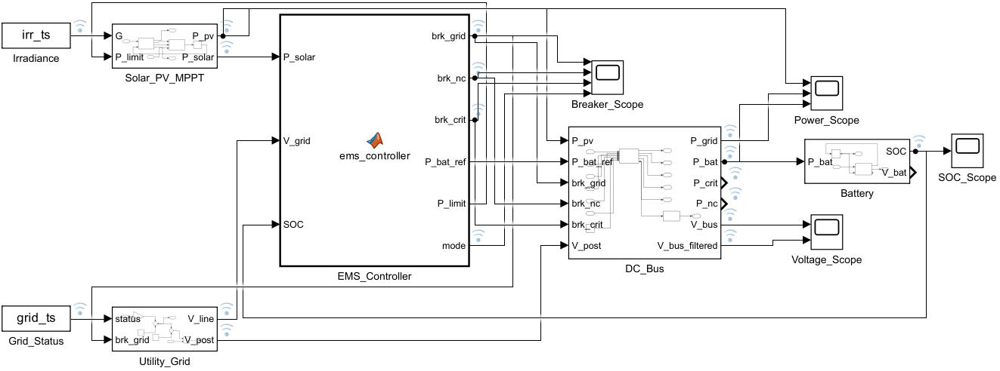
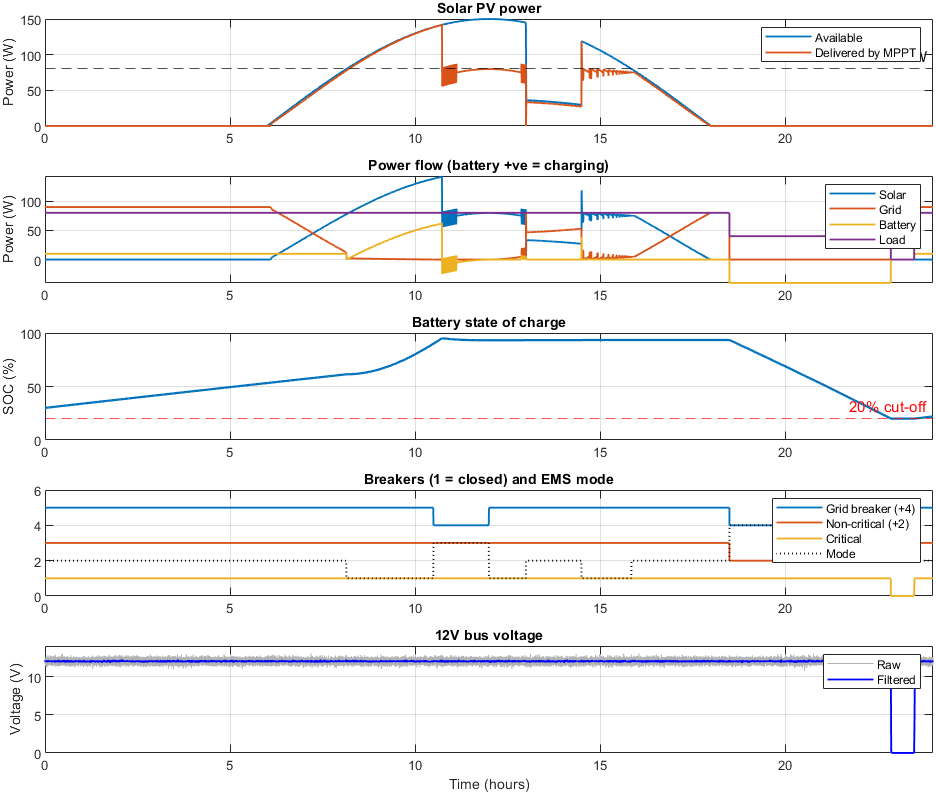
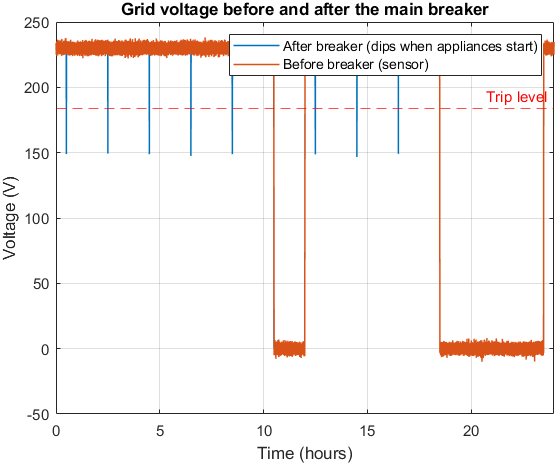

# Reconfigurable Microgrid Controller

A MATLAB/Simulink project for managing a 12 V DC microgrid supplied by solar PV, the utility grid, and a backup battery. The controller changes the source and load configuration as sunlight, grid availability, and battery charge change throughout the day.

The main goal is to keep the critical load supplied during an outage, shed the non-critical load when power is limited, and avoid unnecessary battery discharge.



## What the controller does

- Uses solar power first and directs surplus power to battery charging.
- Draws the remaining power from the grid when solar generation is insufficient.
- Opens the grid breaker during an outage and selects the loads that can remain connected.
- Uses a 20% SOC threshold for low-battery protection and a 95% threshold to stop charging, with charging enabled again below 90%.
- Measures grid voltage before the main breaker, so the simulated downstream appliance dips do not trigger outage detection.
- Adjusts PV operation through a Perturb and Observe (P&O) MPPT block with a power limit from the controller.

Here, reconfiguration means changing source and load breaker states. The supplied model is a discrete system-level energy-management simulation; it does not model transistor-level rectifier/inverter switching.

## Run the project

The original project was developed with MATLAB R2023a and Simulink. It uses MATLAB Function blocks and does not require Simscape. The model builder also uses the Stateflow API to populate those blocks.

1. Download or clone this repository.
2. Open the repository folder as the MATLAB current folder.
3. Run:

```matlab
run_microgrid
```

This simulates 24 hours and opens the power-flow, SOC, breaker-state, bus-voltage, and grid-voltage plots. It also prints energy totals and mode durations in the Command Window.

To inspect the diagram:

```matlab
open_system('SolarMicrogrid.slx')
```

After editing a function in `blocks/`, rebuild the model before running it:

```matlab
build_microgrid_model
run_microgrid
```

The builder replaces `SolarMicrogrid.slx`. Save any manual model edits separately before rebuilding. The run script clears the workspace and closes open figures.

## Default configuration

| Parameter | Value |
|---|---|
| DC bus | 12 V |
| PV available-power rating | 150 W |
| Critical / non-critical load | 40 W / 40 W |
| Battery | 12 V, 20 Ah |
| Initial battery SOC | 30% |
| SOC operating thresholds | 20% minimum, 95% charging cutoff |
| Maximum charging reference | 100 W |
| Grid trickle-charge reference | 10 W |
| Nominal grid voltage / trip threshold | 230 V / 184 V |
| Grid power limit | 200 W |
| Simulation step / duration | 1 s / 24 h |

Change these values and the irradiance/outage profiles in [`microgrid_params.m`](microgrid_params.m).

## Operating modes

The EMS uses available solar power, filtered incoming grid voltage, and battery SOC. Conditions are evaluated in the order shown in [`ems_controller.m`](blocks/ems_controller.m).

| Mode | Condition | Controller response |
|---|---|---|
| 1 | Grid available; solar covers 80 W | Keep both loads connected; use surplus solar for charging |
| 2 | Grid available; solar below 80 W | Keep both loads connected; grid covers the deficit and charging reference |
| 3 | Grid unavailable; solar covers 80 W | Open grid breaker; retain both loads and allow surplus charging |
| 4 | Grid unavailable; solar below 80 W; SOC above 20% | Shed non-critical load; battery supports the critical-load deficit, or charges if solar exceeds 40 W |
| 5 | Grid unavailable; solar below 80 W; SOC at or below 20% | Shed non-critical load; keep critical load only when available solar reaches 40 W; set battery reference to zero |

Battery power is positive when charging and negative when discharging. Available PV power (`P_solar`) and delivered PV power (`P_pv`) are separate signals.

## Test day and results

The included scenario has sunlight from 06:00 to 18:00, a cloud interval from 13:00 to 14:30 at 25% of the normal irradiance, and two outages:

| Interval | Event |
|---|---|
| 10:30–12:00 | Daytime grid outage |
| 18:30–23:30 | Evening grid outage |



The supplied plot shows the battery charging through the morning, the non-critical load being shed during the evening outage, and the critical load disconnecting near the end of that outage as SOC reaches its lower threshold. Supply returns when the grid becomes available again.



The voltage plot compares the incoming-line measurement used by the EMS with the downstream voltage containing the simulated appliance dips. These images are the original project exports, not newly generated simulation results.

## Files

| File | Purpose |
|---|---|
| `SolarMicrogrid.slx` | Ready-to-open Simulink model |
| `microgrid_params.m` | Parameters, irradiance and outage profiles |
| `run_microgrid.m` | Simulation, plotting and summary output |
| `build_microgrid_model.m` | Rebuilds the model from source |
| `blocks/ems_controller.m` | Five-mode energy-management logic |
| `blocks/mppt_po.m` | P&O duty-cycle control and PV power limiting |
| `blocks/pv_buck.m` | Simplified PV and buck-converter model |
| `blocks/battery_model.m` | Battery SOC rate and voltage calculation |
| `blocks/dc_bus.m` | Source/load power balance and bus-voltage output |
| `docs/images/` | Original model and simulation screenshots |

## Model scope

This model is intended for studying supervisory control over a daily operating profile. The bus voltage is assigned from the nominal voltage plus simulated ripple whenever a load is connected; it is not a dynamic converter-regulation result. Battery power is calculated from the bus balance, so a zero battery reference alone is not a physical battery disconnect. Fast electrical transients, switching losses, hardware protection and experimental validation are outside the current model.

The repository packaging and documentation were checked against the supplied source and images. The simulation has not been rerun as part of this repository update.
